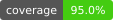

<h1 align="center">
  <picture>
    <source media="(prefers-color-scheme: dark)" srcset="assets/brand/rail-dark.png">
    <source media="(prefers-color-scheme: light)" srcset="assets/brand/rail-light.png">
    
  </picture>
</h1>

[](https://github.com/vitosans/rail/actions/workflows/ci.yml?query=branch%3Amain)
[](https://github.com/vitosans/rail/actions/workflows/codeql.yml?query=branch%3Amain)
[](https://github.com/vitosans/rail/actions/workflows/ci.yml?query=branch%3Amain)
[](https://github.com/vitosans/rail/tags)
[](Cargo.toml)
[](#install)
[](#license)

Rail is a terminal mail client for Gmail and Microsoft 365, written in Rust.

It keeps a local copy of your mail in SQLite, synced by a small background daemon. Every list,
search and open is a local query, so the interface never waits on the network.

It is built for people who live in a terminal and want something in the spirit of mutt, with
threads, a unified inbox across accounts, readable HTML and a command palette. It also speaks MCP,
so an AI coding agent can help you set it up without ever seeing your secrets.

<p align="center">
  
</p>
<p align="center"><sub>The mail screen at 150 columns: the sidebar, the unified inbox and an open thread, with the keys for the pane you are in along the bottom. The accounts and the mail in these pictures are invented.</sub></p>

<p align="center">
  
</p>
<p align="center"><sub>A short tour: open a thread and turn its older messages round with <code>:thread-order</code>, page the sidebar with <code>Ctrl-d</code>, turn the key hints off with <code>:hints</code>, and preview themes as you type in <code>:theme</code> (<code>Esc</code> puts yours back).</sub></p>

<table>
  <tr>
    <td width="50%" valign="top" align="center">
      <br>
      <sub>The thread list: date groups, an unread dot in the account's colour, the account's badge, the people, stars and attachments, the message count after the subject and the time at the edge.</sub>
    </td>
    <td width="50%" valign="top" align="center">
      <br>
      <sub>A thread: the title block, the newest message open with its quoted lines folded, and the older messages as numbered cards. <code>n</code> and <code>p</code> move between messages, <code>Tab</code> opens or folds one.</sub>
    </td>
  </tr>
  <tr>
    <td width="50%" valign="top" align="center">
      <br>
      <sub>A message after <code>h</code>: the From, To and Date lines above the body. The title block shows names only, so the addresses stay out of the way until you ask.</sub>
    </td>
    <td width="50%" valign="top" align="center">
      <br>
      <sub>The command palette on <code>:</code>: every command with its key, narrowed as you type. Themes, mailboxes and the settings toggles live here too.</sub>
    </td>
  </tr>
  <tr>
    <td colspan="2" valign="top" align="center">
      <br>
      <sub>The sidebar: the merged mailboxes across every account, then each account with its badge, its system folders and <code>More folders</code> for the rest, folded and unfolded with <code>Space</code>.</sub>
    </td>
  </tr>
</table>

> **Rail is pre-1.0.** Account setup, background sync, search, reading mail, acting on threads
> (archive, trash, star, read, move) and writing mail (new messages, replies and forwards, with
> undo send, and drafts saved to the account's Drafts) work today for Gmail and Microsoft 365.
> Labels are Gmail's; on Microsoft 365 `m` moves to a folder instead.

## Features

- **Local first.** A unified inbox and per-account and per-label lists over a local store, kept
  current by a background daemon that can start at login.
- **A reader built for threads.** Opens on the newest message with the older ones as cards,
  folded quotes, numbered (clickable) links, and HTML mail drawn with its styles and pictures
  (remote pictures only when you ask).
- **Fast to drive.** Filter as you type, saved searches, a command palette, selections and bulk
  actions with undo, snooze, and keys you can change (with `vim`, `mutt`, `emacs`, `gmail` and `outlook` presets).
- **Writing in your own editor**, with a ten second undo send and drafts that sync to the
  account's Drafts.
- **Gmail and Microsoft 365**, including organisation presets and Microsoft admin consent.
- **Tokens kept safe** in the OS keyring, a private file or 1Password.
- **`rail doctor`**, a single health check, and an **MCP server** for setting Rail up from an AI
  agent.

## Install

### Binaries

Binaries are available on the [GitHub releases page](https://github.com/vitosans/rail/releases)
with SHA-256 checksums:

| Platform | Requirement |
|---|---|
| Linux x86_64 and ARM64 | glibc 2.36 or newer |
| macOS on Apple Silicon and Intel | macOS 11 or newer |

Up to v0.2.3 only Linux x86_64 was published.

Extract the archive and put `rail` in a directory on your `PATH`. GitHub Actions builds each
archive and attests where it came from; check one with
`gh attestation verify <archive> --repo vitosans/rail`. Build from source on other systems.

### From source

You need Rust 1.90 or newer and a C compiler (SQLite is bundled and compiled in). Supported
platforms are Linux and macOS.

```sh
git clone https://github.com/vitosans/rail
cd rail
cargo install --locked --path crates/rail
```

This puts `rail` in `~/.cargo/bin`. To upgrade, pull and run the same command.

The first command of the new version replaces any older daemon still running, including one from
an earlier build of the same version. When an upgrade changes the store, the new daemon migrates
it the first time it starts (rebuilding the search index can take a moment on a large mailbox);
until then the mail screen says the store is not set up.

### Nix and NixOS

The repository ships a `flake.nix` with the package, a development shell and a formatter:

```sh
nix run github:vitosans/rail               # run Rail without installing it
nix profile install github:vitosans/rail   # put `rail` on your PATH
```

Both build the latest commit on `main`; `nix profile upgrade rail` rebuilds from it again.

On NixOS or with home-manager, add the flake as an input and install its package:

```nix
inputs.rail.url = "github:vitosans/rail";

# NixOS: environment.systemPackages = [ inputs.rail.packages.${pkgs.stdenv.hostPlatform.system}.default ];
# home-manager: home.packages = [ inputs.rail.packages.${pkgs.stdenv.hostPlatform.system}.default ];
```

For development, the shell has the Rust version `rust-toolchain.toml` pins, with `clippy`,
`rustfmt`, `cargo-deny` and `cargo-llvm-cov`, the same set CI uses:

```sh
nix develop                       # enter the development shell
nix build                         # the binary at ./result/bin/rail
cargo test --workspace --locked   # inside `nix develop`
```

`direnv allow` loads that shell automatically when direnv and nix-direnv are installed. The Nix
package builds with `doCheck = false`: the test suite binds loopback sockets and drives the binary
in a pseudo-terminal, and the Nix sandbox allows neither, so run the tests from `nix develop`.

The Nix package links nixpkgs' SQLite rather than the copy Rail bundles, as nixpkgs does for every
Rust package, so SQLite updates come with nixpkgs.

## Quick start

```sh
rail                       # read your mail
rail setup                 # add an account: guided steps, then a browser login
rail sync                  # fill the local store and watch progress
rail search invoice        # one line per matching thread
rail doctor                # check that everything is in order
rail daemon install        # keep syncing after you log out and back in
```

1. **`rail setup`** opens the setup wizard, which shows the portal steps, asks for the values the
   portal gave you, and logs you in through the browser. See [Account setup](docs/accounts.md).
2. **`rail sync`** fills the local store. Newest mail arrives first, but a first sync of a large
   mailbox takes hours; set [`history_days`](docs/configuration.md#sync-settings) to sync only
   recent mail.
3. **`rail`** opens the mail screen. Press `?` for the keys of the view you are in, or `:` for the
   command palette. See [Reading mail](docs/reading.md).
4. **`rail daemon install`** starts the daemon at login. Without it, the daemon starts on demand.

Every command and flag is in [Commands](docs/commands.md).

## Documentation

| Page | What it covers |
|---|---|
| [Account setup](docs/accounts.md) | The setup wizard, Gmail and Microsoft 365 app registration, admin consent, Microsoft 365 differences, organisation presets. |
| [Reading mail](docs/reading.md) | The mail screen, the reader, pictures, links, attachments, filtering, saved searches, the palette, themes. |
| [Doing things to mail](docs/actions.md) | Archive, trash, star, labels, moving, selections, undo, snooze. |
| [Writing mail](docs/writing.md) | The editor, the review, sending with undo, drafts, limits. |
| [Keys](docs/keys.md) | Key names, `[keys]`, presets, editing keys in text fields, and every action with its default keys. |
| [Configuration](docs/configuration.md) | Every `config.toml` setting, sync, 1Password, file locations, the daemon. |
| [Commands](docs/commands.md) | Every command, its flags and exit codes. |
| [MCP](docs/mcp.md) | Using Rail from an AI agent. |
| [Security and privacy](docs/security.md) | Tokens, local storage, remote content, logs. |
| [Troubleshooting](docs/troubleshooting.md) | Common messages and fixes, Microsoft sign-in errors. |

## Status

**Coming next:** agent tools for drafts and sends, the last piece of mail work, governed by the
per-account [`ai_send`](docs/configuration.md#ai_send-what-an-ai-agent-may-do-with-your-mail)
policy. **Later:** search operators, layout options.

**Pre-1.0 caveats.** Config keys, command output and the store's schema may change between
releases. The store migrates forward on its own; there is no downgrade path. Rail is tested on
Linux and macOS only.

## Contributing

Bug reports and pull requests are welcome. See [CONTRIBUTING.md](CONTRIBUTING.md) for the
development loop, ground rules and commit format, and [CHANGELOG.md](CHANGELOG.md) for what has
shipped.

## License

Licensed under either of

- Apache License, Version 2.0 ([LICENSE-APACHE](LICENSE-APACHE))
- MIT license ([LICENSE-MIT](LICENSE-MIT))

at your option.

The colour schemes behind `:theme` are the
[iTerm2-Color-Schemes](https://github.com/mbadolato/iTerm2-Color-Schemes) collection,
© 2011 to present Mark Badolato, MIT licence.
